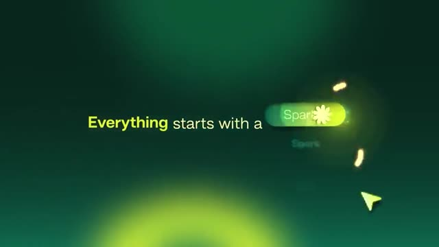
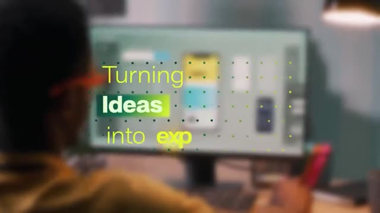
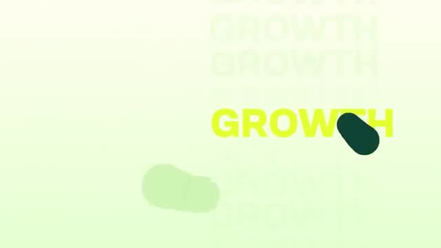
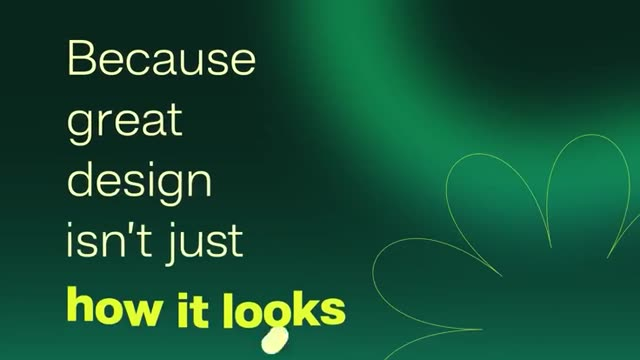
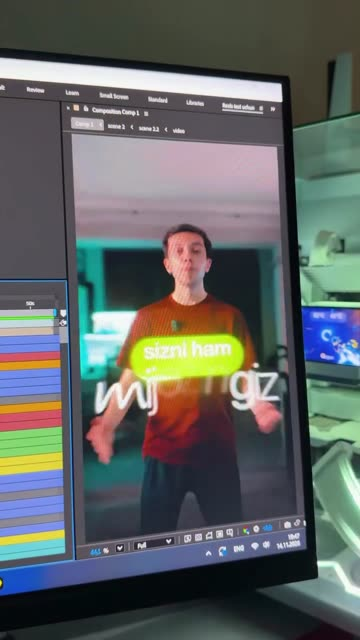
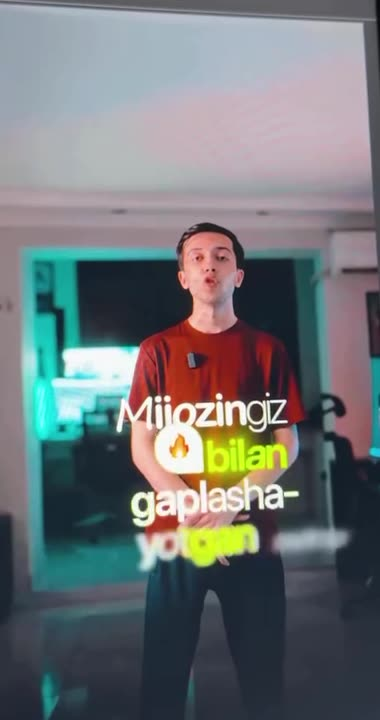
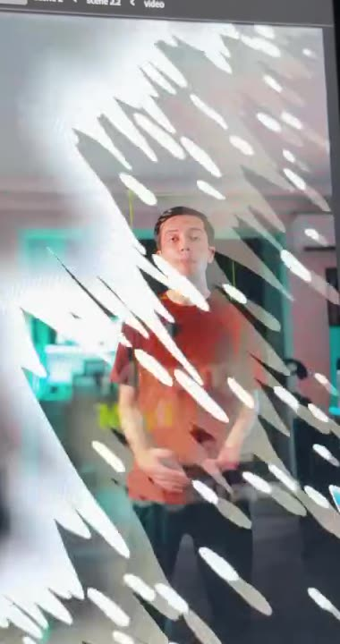
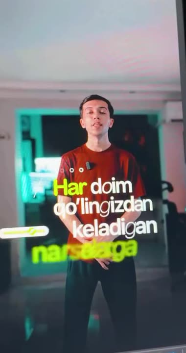

# Reference montage styles (2026-11-15)

Two reference videos the user sent, measured so an editor or agent can reproduce their editing style in reels. The videos are not in the repo; stills are in [`refs-2026-11-15/`](refs-2026-11-15/).

| | A | B |
|---|---|---|
| Source | Instagram, user `baikovphilipp` | unknown (Uzbek-language reel) |
| Format | 736x414 landscape, 30 fps, 47.3 s | 720x1280 vertical, 30 fps, 46.2 s |
| What it is | Fully animated brand/agency promo: kinetic typography, abstract shapes, UI mock-ups, two stock-footage inserts | Phone filming a monitor that plays an After Effects preview of a talking-head reel with heavy kinetic captions and UI inserts ("look what I'm editing" BTS format) |
| Voice | Yes: female voice-over reading the on-screen text | None detected; the talking head on screen is silent, music + SFX only |
| Music | Soft ambient/corporate pad, no kick, ~120 BPM feel, sits under the voice | Electronic track, four-on-the-floor kick at **104.4 BPM** (0.575 s), drop at 5.14 s, breakdown 23.0-30.5 s, sidechain pumping |
| SFX | Sparse and subtle (soft filtered swishes, ticks) | Dense, designed (downer boom, shimmer cascades, glitch clicks, blips, zips, whooshes) |

## Method

- Cuts: `scenedetect detect-adaptive` on the full frame, plus per-frame luma difference and 32-bin histogram distance (OpenCV). For B the detection was re-run on a crop of the monitor's composition viewer (`crop=380:720:180:300`), because inner cuts change only part of the phone frame.
- Frames: 1 fps contact sheets for the whole of each video, plus 4-10 fps sheets on the hook and the main transitions, all read by eye.
- Audio: librosa beat tracking; sub-band (30-100 Hz) onset autocorrelation for the kick grid; mel and linear spectrograms in 12 s windows with cut markers, and zoomed 1-3 s windows around every transition; a side-channel (L-R) spectrogram for A, which removes the centred voice; HPSS, spectral flatness and a band-limited-noise detector for SFX candidates.
- Limits: no speech recognition or stem separation was available, so the voice-vs-SFX split is read from spectrogram shape (formants and pitch glides mean voice; stepped pitch cascades, band-limited noise blocks and sub drops mean SFX). Timestamps are good to about 30-50 ms. The SFX lists for A are low confidence and the ones for B are medium-high.
- Colours for B were measured through the phone camera, so they are shifted (shown lime `#bad810`; the real comp lime is probably closer to `#c8f000`).

---

## A: kinetic-type brand promo (baikovphilipp)

### Structure and pacing

Scenedetect sees 7 "scenes" (ASL 6.8 s), but most changes are animated morphs rather than cuts. Counting every new text/visual beat, there are about 22 beats in 47 s, so roughly **one beat every 2.1 s**. There are 4 hard cuts (14.20, 19.87, 23.80, 42.10); everything else is a morph, wipe or camera move inside one continuous animated world.

| Time (s) | Beat | Transition in |
|---|---|---|
| 0.0-2.6 | Hook: "Everything starts with a [Spark]" typed word by word (0.6-1.2), a cursor drags a glowing pill "Spark" into the sentence (1.6) | opens on a glowing ring, no black |
| 2.6-4.0 | Spark becomes a white circle burst, the sentence collapses into it, then "Idea" on a thin circle-line grid | circle burst/iris |
| 4.0-6.0 | "Sketch" written along an arc, white blob sweeps across | shape wipe (4.47) |
| 6.0-7.0 | "Question" (letters shuffle in, one letter swapped) | morph |
| 7.0-9.0 | "What if this could *grow*?" with a spinning neon square and a yellow flower | morph |
| 9.0-14.2 | Stock footage: man at a desk, blurred, with "Turning / **Ideas** / into **experiences**" over it (lime box behind "Ideas") | green parallelogram wipe (10.4) |
| 14.2-17.7 | Light mint world: "GROWTH" with stacked ghost/outline repeats above and below | hard cut dark to light (14.20) |
| 17.7-19.8 | "CLARITY" ghost type, green ribbon swooshes carry the word "clarity" | ribbon wipe |
| 19.9-23.8 | Framed stock footage: woman at a laptop, a ring ribbon orbits the frame | hard cut (19.87) |
| 23.8-28.0 | Dark again: UI dashboard cards fly in on a 3D tilt | hard cut (23.80) |
| 28-29.5 | "Design" with a lime underline bar | morph |
| 29.5-32.5 | Weather-app UI card ("Hello, Lucy") in a phone frame, push-in | morph |
| 32.5-36 | "Smart layouts", then "Clear actions" with a lime path animating through a UI grid | slide (32.5), morph (33.8) |
| 36-38.5 | "All **crafted** to move" with flower/sticker icons | morph |
| 38.5-42.1 | Left-aligned stack, one line every ~0.5 s: "Because / great / design / isn't just / **how it looks**" (last line bold lime) | morph |
| 42.1-46.5 | Light: "It's how it [works]" (lime box), then end card "Ready to grow?" | hard cut (42.10) |
| 46.5-47.3 | Fade to black | |

- Hook: the first frame already has text ("Everything") and a glowing ring, and the first word is spoken at 0.25 s. The open is a promise sentence with a gap ("starts with a ...") that the animated spark fills at 1.6 s.
- Ending: a call-to-action question on the light background, held 2.5 s, then a 0.5 s fade to black.
- Rhythm: dark green and light mint sections alternate (0-14 dark, 14-24 light, 24-42 dark, 42-47 light). The light sections carry the big abstract words (GROWTH, CLARITY, "It's how it works").

### Visual style

- Palette: deep greens `#052921` / `#074637` / `#08664f`, teal glow `#0b9b7c`, accent lime `#e1ee31`, light mint backgrounds `#f7fbe5` / `#ecfad9` / `#cdebb1`, dark-green ink `#457952` on light. Large soft radial gradients and blurred rings act as "lights".
- Type: a geometric grotesk (Poppins/Gilroy-like). Mixed weights inside one line: key words bold or lime, the rest regular white. Sizes as a share of frame height: body sentence about 3-4% (small, centre), single hero words 5-7% ("Idea", "GROWTH"), stacked closing lines about 6%. Positions are mostly centre or left-third; nothing sits in the lower-third caption zone.
- Text animation: word-by-word typing (about 0.15 s per word), per-letter rise/scramble ("Question", "desig n"), lime highlight boxes that wipe in behind a word ("Ideas", "works"), ghost echo copies (outlined, 10-15% opacity) stacked above and below hero words, and text written along an arc.
- Graphics: thin circle-line grids, glowing rings, a cursor arrow, lime/dark-green ribbons with gradient ends, flower/asterisk stickers, UI cards on a 3D tilt with depth of field.
- Camera moves are virtual: slow push-ins on UI (about 5-10% over 2-3 s), 3D tilts, parallax. There are no speed ramps on footage; footage is blurred or framed in a card, never full-bleed sharp.
- Transitions: morphs and shape wipes (circle burst, parallelogram wipe, ribbon sweep, white blob). Hard cuts are used only to flip between the dark and light worlds.
- Grade: footage is pushed toward the green palette and kept soft (blur or vignette) so the type reads.

### Audio

- Voice-over: a female voice reads the on-screen text, closely synced (for example "Because great design isn't just how it looks" is spoken 39.6-41.9 while the lines reveal). Formant structure is clear at 0.25-1.6 and 39.6-42.9 s. There are speech pauses around 16.0 and 29 s.
- Music: a soft pad/ambient bed (sustained harmonics around 250-1,500 Hz, stereo), no kick drum. Beat trackers give 117-132 BPM inconsistently, a sign there is no strong pulse. **Cuts do not lock to beats** (mean cut-to-nearest-beat offset 124 ms against a 112 ms random baseline). Cuts follow the voice phrases instead: each new phrase starts a new visual beat.
- SFX (low confidence, mixed about 15-20 dB under the voice, found in the side channel where the centred voice cancels):

| Time (s) | Type | Context |
|---|---|---|
| 0.28 | soft high tick/sparkle (4-10 kHz, about 50 ms) | first frame, ring glows |
| 4.08-4.20 | band-limited swish (5-8 kHz, about 0.12 s) | "Sketch" arc/blob sweep |
| 7.6-7.75 | airy swish (5-10 kHz) | neon square spins in |
| 19.88 | short filtered tick | hard cut to the laptop footage |
| 27.9-28.15 | band-limited swish (5-8 kHz, about 0.25 s) | UI dashboards fly out |
| 31.0 | louder swish/tick | UI card build |
| 42.06 | short filtered tick | hard cut to the light end section |

No impacts, risers, bass drops or whooshes with a low end were found. The sound design is "voice + pad + tiny air swishes".

---

## B: BTS monitor-shot reel with kinetic captions and UI inserts

### Structure and pacing

The outer layer is one continuous handheld phone shot of a vertical monitor showing After Effects (layer timeline on the left, "Composition Comp 1" tab). Gentle drift of about ±30 px at about 6 px/s, no cuts. All editing lives in the comp on screen.

Inner cuts (detected on the cropped viewer): 8 shots, **ASL 5.8 s**. The long UI build (14.0-32.0) inflates that; the talking-head shots are 2.5-4.8 s and caption groups change every 1-1.5 s.

| Time (s) | Shot | Transition in |
|---|---|---|
| 0.0-0.5 | Hook: defocused talking head, a vertical light streak shoots up (0.2-0.3), a lime glowing pill "sizni ham" pops in, the focus racks sharp by 0.5 | opens mid-blur |
| 0.5-4.17 | Talking head, captions word by word: "sizni ham / *mijozingiz* / bir martdagina / zakaz berib", then "keyingi safar ..."; lime scribble doodles at the frame edges | |
| 4.17-9.0 | White UI insert: lime button morphs, cart icon with red badge (6.0), order summary card with "707$" total (7-8.9) | flash/whoosh cut to white |
| 9.0-11.5 | Talking head: "Mijozingiz / [fire emoji] **bilan** / gaplasha- / yotgan paytingiz"; a lime face-tracker box draws round the face (10.6-11.0), the image desaturates to grey (11.0-11.4) | cut on the music |
| 11.5-14.0 | Talking head in colour: "Mayli qanday dur ..." | white shard/shatter burst wipe (11.4-11.6) |
| 14.0-32.0 | White UI: lime chat-app card builds and fills step by step (to 29), then the "a!" app icon (29-32) | cut to white |
| 32.0-34.95 | Talking head: "**Har** doim / qo'lingizdan / keladigan / **narsalarga**", then a lime bar and a white pill card fly over him | **zoom-through**: push into the hole of the "a!" icon, which becomes a lime circular window onto the next shot (32.0-32.3) |
| 34.95-42.55 | White: "707$" pill (35-36), then chat bubbles animating in a grid (36.5-42.5) | blur whip to white |
| 42.55-46.1 | Talking head, clean, no captions, held to the end | cut on the kick |

- Hook: within 0.5 s there is a light-streak flash, a glowing pill word and a focus pull, plus the meta-hook of "you're watching me edit this in AE". A downward pitch-sweep boom hits at 0.25-0.38 s.
- Ending: no CTA card; it returns to the clean talking head and holds about 3.5 s (looks like the preview just runs out).

### Visual style

- Palette: white UI backgrounds, lime accent (shown through the camera as `#bad810`), dark slate `#252d37`, teal room glow in the talking-head plate, red T-shirt. Captions are white + lime only.
- Captions: a bold grotesk (Montserrat/Inter-like), lowercase Uzbek. Each line has 1-2 words; keywords are lime and/or heavier weight; one word per group may be a white **script/brush italic** ("mijozingiz"). They stack left-aligned or centred over the torso, at about 45-70% of the reel height and about 60-75% of its width. Word height is about 4-6% of the frame height.
- Caption animation: each word pops in with a **blur-to-sharp + small scale-up + lime glow flash** (about 4 frames), about 3 words/s (0.15-0.3 s apart). Groups hold about 1-1.5 s, then blur/dissolve out in about 0.2 s. Accents: lime pill behind a word with outer glow, emoji badge in a circle ("[fire emoji] bilan"), a hyphenated word split across two lines ("gaplasha-/yotgan"), small lime UI bars that slide in beside the stack.
- Effects: light-streak flash, focus rack, face-tracker box (lime corners), grey desaturation freeze before a transition, white shard shatter wipe, zoom-through-object transition, lime scribble/brush doodles, motion blur on every fly-in.
- UI inserts: flat white background, lime rounded cards (radius about 8% of the card width), icons with badges, price "707$", chat bubbles. Elements build step by step on the music.
- Footage grade: cool teal background with a warm subject, mild contrast, no heavy LUT.

### Audio

- Music: electronic, kick every 0.575 s (**104.4 BPM**) from the drop at 5.14 s; breakdown with no kick 23.0-30.5 (a pitched pluck/vocal-chop line); kick back at 30.5. RMS shows clear sidechain pumping on every kick. The intro (0-5.1) has no kick: glitchy texture plus SFX.
- Cut sync: the inner cuts at 11.50 (0 ms), 14.03 (-60 ms), 42.55 (-60 ms) land on a kick. The animated transitions at 32.1 and 34.95 *start* 120-160 ms before a kick so that they *resolve* on it (32.22, 35.11). Rule: cut on the kick, or start a 4-5 frame transition so it ends on the kick. The cut at 9.0 sits 190 ms early (a third of a beat). The cut at 4.17 is in the intro, before the drop.
- Voice: none detected.
- SFX (spectrogram-confirmed, mixed loud, many stereo-wide):

| Time (s) | Type | Context |
|---|---|---|
| 0.22-0.38 | **downer / pitch-drop boom**: sweep 2.5 kHz to 100 Hz with a sub hit | hook flash and pill pop |
| 0.48-0.55 | bright metallic **click/ping** (4-10 kHz) | focus snaps sharp, caption lands |
| 0.5-0.7 | short falling **laser zaps** | first caption words |
| 2.6-3.0 | cluster of digital **ticks** | caption words popping |
| 3.10-3.95 | **shimmer cascade**: stepped falling pings 9 kHz to 3 kHz, steps about 80 ms | caption group exits |
| 4.05-4.45 | stuttering low **bass pulses** ramping, then an upward **zip/riser** 1 to 10 kHz (4.38-4.5) | transition to the white UI (4.17) |
| 5.14 | music **drop** (kick enters) | first UI animation |
| 9.8-10.2 | **bubble pops/blips** (1-3.5 kHz) | caption words "bilan / gaplasha" pop in |
| 11.0-11.3 | **downward zip** (2.4 to 1.3 kHz and 1 kHz to 100 Hz) | grey freeze, before the shatter |
| 11.4-11.6 | transient/whoosh (broadband) | shard shatter wipe |
| 14.3-15.05 | **shimmer cascade** (same sample as 3.1) | cut to the white chat UI |
| 15.1-15.6 | soft **UI ticks/pops** | card elements build |
| 32.3-33.05 | **shimmer cascade** (same sample) plus 2 **glitch clicks** (32.85, 33.05; broadband 3-11 kHz) | zoom-through into the talking head |
| 34.85-35.0 | **soft whoosh** (broadband noise swell) | blur whip to white "707$" |
| 38.8-39.4 | **digital blips/beeps** (pitched at 3, 4.7 and 5 kHz) plus a click at 39.45 | chat bubbles appear |
| 40.3-42.5 | quiet high **riser** (4 to 8 kHz) into the cut | cut back to the talking head (42.55) |

The kit is small and reused: the shimmer cascade appears 3 times, always on a section change.

---

## Style recipes

### Recipe A: "kinetic brand promo" (voice-led motion graphics)

- Format: 16:9 or 9:16; 45-50 s; about 20 beats, **one visual beat per voice phrase, 1.5-3 s each**; 3-5 hard cuts total, used only to flip dark and light worlds.
- Hook (0-2.5 s): a sentence with a gap ("Everything starts with a ...") typed word by word (0.15 s per word); an animated object fills the gap at 1.5-2 s.
- Body: alternate dark green (`#052921`-`#08664f`, radial glows) and light mint (`#f7fbe5`) sections every 10-15 s. One hero word per beat (5-7% of frame height) with ghost echo copies at 10-15% opacity. Stock footage only blurred or framed in a card, with type on top.
- Type: geometric grotesk; body 3-4% of frame height, hero 5-7%; key word bold or lime `#e1ee31`; lime highlight box that wipes in behind a word in 6-8 frames; closing statement as a left-aligned stack, one line every 0.5 s, last line bold lime.
- Motion: everything eases (no linear moves); morphs and shape wipes between beats (circle burst, ribbon, parallelogram); slow virtual push-ins of 5-10% over 2-3 s; 3D-tilted UI cards with depth of field.
- End: CTA question on the light background, hold 2.5 s, fade to black 0.5 s.
- Audio: voice-over drives all timing (a visual beat starts within 0.1 s of the phrase onset); soft pad music at about -18 dB under the voice, no kick; SFX only as filtered air swishes/ticks (5-8 kHz band, 0.1-0.25 s) at about -20 dB under the voice, on fast shape moves and on the 3-5 hard cuts. No impacts or risers.

### Recipe B: "BTS hype talking head" (music-led captions and UI)

- Format: 9:16, about 45 s. Optional meta layer: film the comp on a monitor with a phone (gentle handheld drift of about ±30 px).
- Shots: talking-head shots of 2.5-5 s alternating with white UI inserts of 5-18 s; caption groups change every **1-1.5 s**; cut on the kick (**104 BPM: 0.575 s grid**), or start a 4-5 frame transition so it ends on the kick.
- Hook (0-0.5 s): start defocused, vertical light-streak flash at 0.2 s, glowing lime pill word pops, focus racks sharp by 0.5 s; downer/pitch-drop boom plus a click on it.
- Captions: bold grotesk, 1-2 words per line, stacked over the torso (45-70% of the frame height, 60-75% of its width), word height 4-6% of the frame height; white with keywords lime, one script-italic word per group, occasional emoji badge or lime pill with glow. Per word: blur 20 px to 0 plus scale 85% to 100% plus a lime glow flash over 4 frames, about 3 words/s. Groups exit with a 6-frame blur dissolve. Use Montserrat or Inter for the Uzbek oʻ/gʻ (see README).
- Transitions (rotate them, one per section): flash/whoosh cut to white; face-tracker box, then grey freeze 0.4 s, then shard shatter wipe; zoom-through an icon hole into the next shot; blur whip.
- UI inserts: white background, lime rounded cards, icons with red badges, price tag, chat bubbles; build one element per beat (0.575 s), motion blur on every fly-in.
- Music: electronic track with a four-on-the-floor kick and sidechain pumping; intro with no kick for 5 s, drop at the first UI insert, breakdown (no kick) through the long UI build, kick back for the last talking-head section.
- SFX placement rules:
  1. Hook: pitch-drop boom plus a metallic click inside the first 0.5 s.
  2. Every section change (talking head to UI and back): one shimmer cascade (falling stepped pings, about 0.8 s) starting on the cut; reuse the same sample.
  3. Every transition effect gets its own sound: zip-up riser into a flash-to-white, downward zip under a grey freeze, whoosh/transient on shatter or blur whip, glitch clicks on a zoom-through.
  4. Caption and UI pops: soft blips/bubble pops/ticks on each word or element, kept 6-10 dB under the music.
  5. Quiet high riser (about 2 s) into the final cut.
  6. Mix the music and SFX hot (no voice), loudest at the hook and at section changes.

### What to reuse from each

- From A: hero-word typography with ghost echoes, dark/light world flips, voice-locked beat timing, restraint in the SFX.
- From B: the caption engine (word pops, lime keywords, script accent word, pill + glow), the kick-locked cutting, the transition-to-SFX pairing, and the reusable shimmer cascade.

## Stills

| | |
|---|---|
|  A 1.8 s: hook sentence with the spark pill |  A 13.0 s: blurred footage with a mixed-weight text stack |
|  A 16.5 s: hero word with ghost echoes on mint |  A 41.3 s: line-by-line closing stack |
|  B 0.6 s: full frame, phone filming the AE monitor |  B 10.3 s: caption stack with an emoji badge |
|  B 11.5 s: shard shatter transition |  B 33.6 s: lime keywords and a sliding UI bar |
